# Clamacs

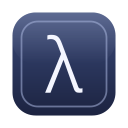

Clamacs is an Emacs-flavoured Common Lisp editor and IDE for AmigaOS 3,
MorphOS, macOS and Linux.  It is written in Common Lisp and runs on
[AmiLisp](https://github.com/mdbergmann/amilisp) (`amilisp`); the Lisp
you work on runs in a *second* amilisp that the editor talks to over a
wire.  Through that wire you load and compile files, evaluate forms,
type at a REPL, step through a debugger when something signals, inspect
values, and ask for arglists, completions, descriptions, apropos,
macroexpansions and source locations.

This is the user guide: how to start the editor, the keys, how to edit,
how to work with amilisp, projects, appearance, the init file and
scripting.  Building and testing the editor is covered in
[docs/developing.md](docs/developing.md).

## Screenshots

### AmigaOS

Taken on a Vampire V4 (AmigaOS 3.2, MUI 3.8, 1280x720) driving the
amilisp from the binary release.

A file loaded with `C-c C-k` and the `*clamacs-repl*` window (`C-c C-z`)
talking to it, the amilisp console at the bottom:

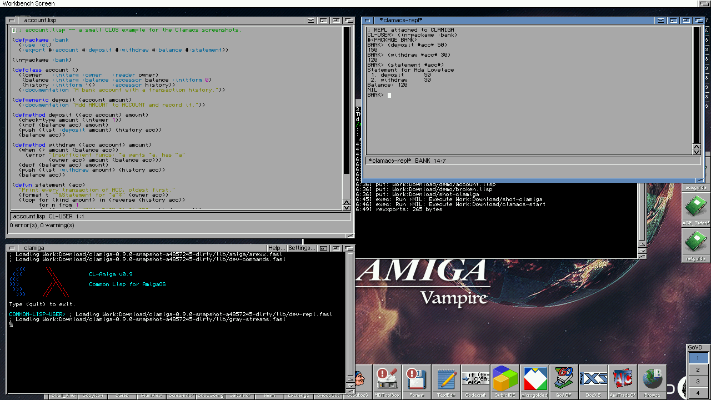

An error signalled at the REPL prompt parks amilisp's REPL thread and opens
the debugger window: condition, restarts, backtrace, the locals of the
selected frame and an eval-in-frame line:

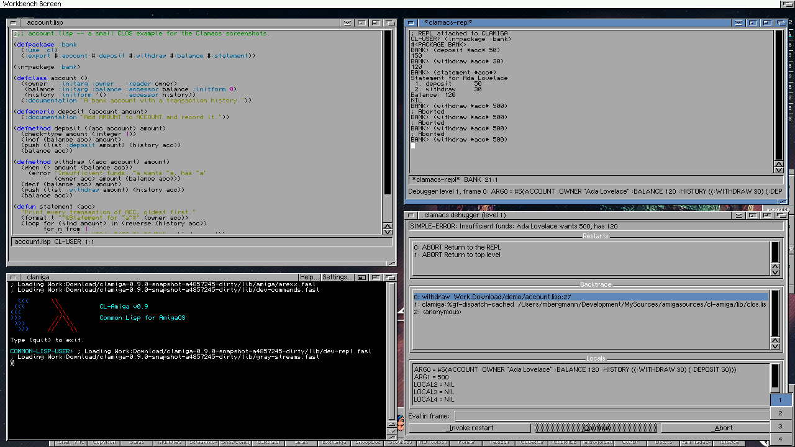

`C-c I` evaluates a form and opens the inspector on its value; a part
descends, Back comes up:

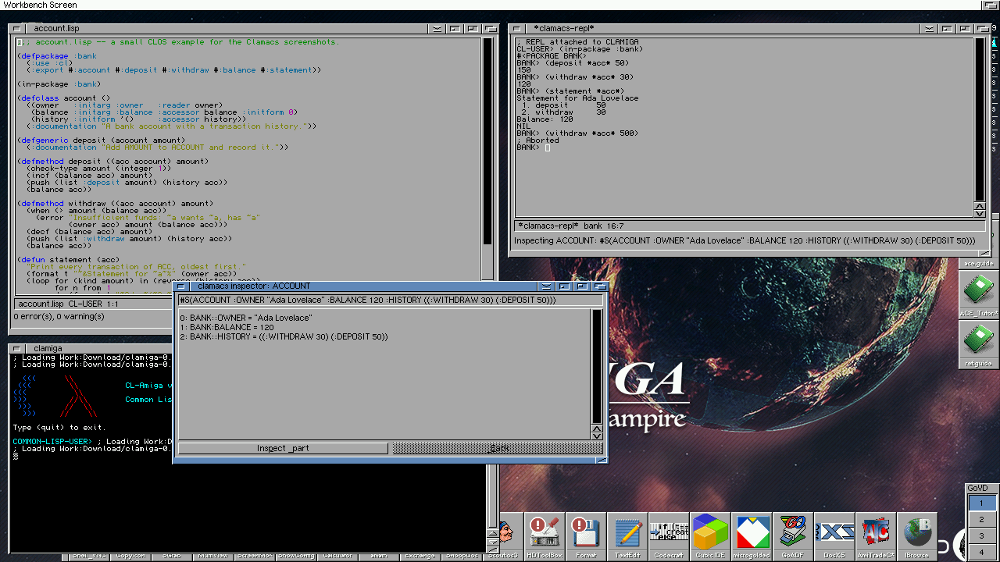

Loading a file with mistakes fills the diagnostics window; a click on a row
or ``C-x ` `` puts the cursor on the offending line, with the message in the
echo area:

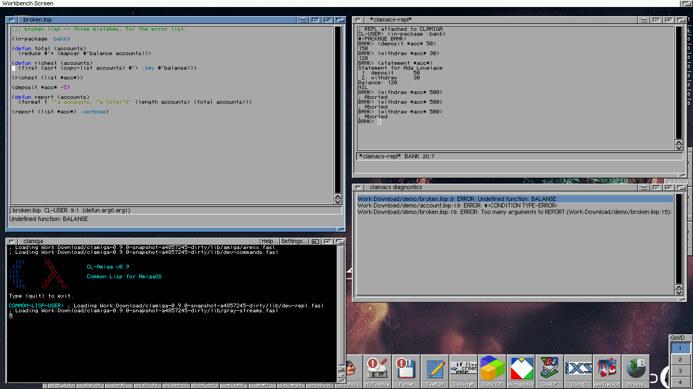

### MorphOS

The same editor on a MorphOS 3.20 box (MUI 4, 1920x1080): a small ledger
loaded with `C-c C-k`, the REPL window that fed it, and the debugger
window an overdraft at the prompt opened:

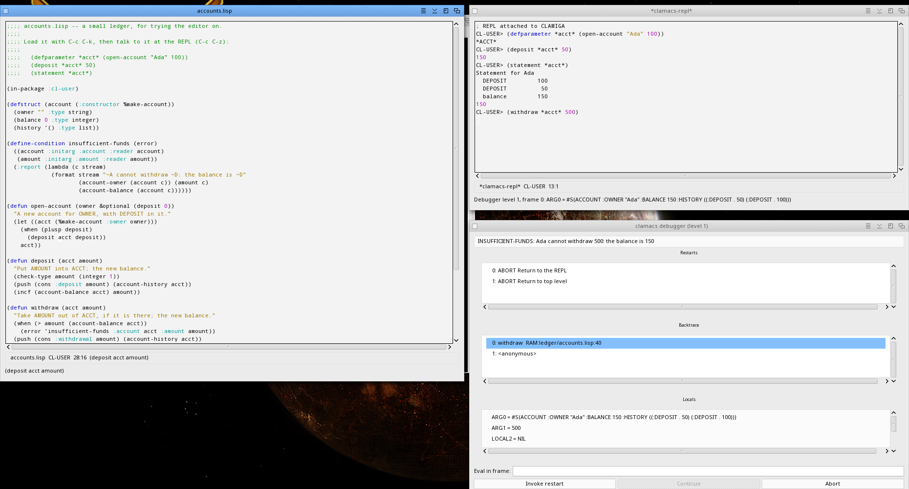

### macOS

The same editor on a Mac: one window, the buffers as tabs, the tools in
a dock below them.

The document window: the source with its colouring and the minimap, the
`*clamacs-repl*` tab in the dock talking to the amilisp the editor
started, a `; Evaluated:` note from `C-c C-c` and the arglist in the
status line:

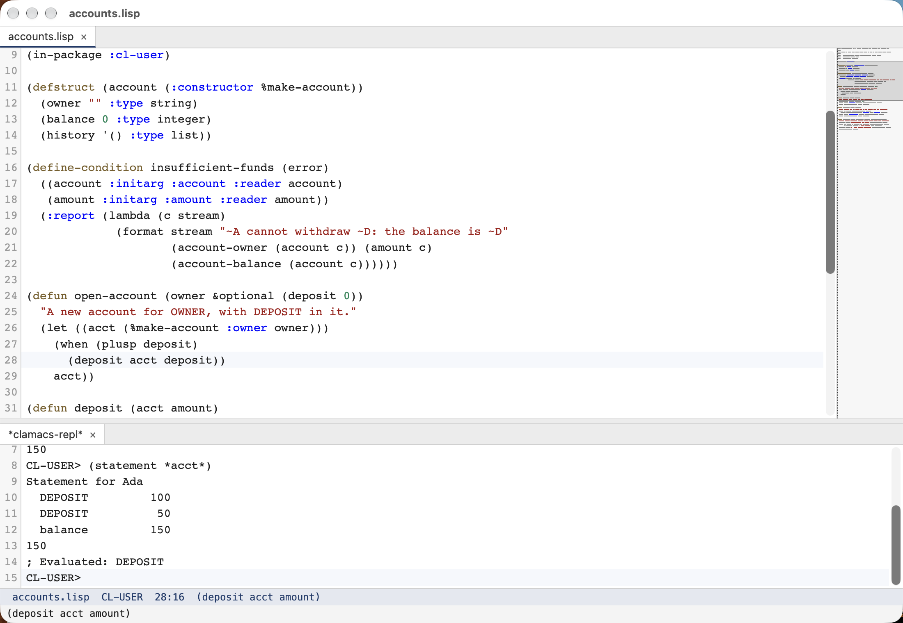

An overdraft signalled at the prompt opens the Debugger panel: the
condition, the restarts, the backtrace with the frame's source line, the
locals of the selected frame, the eval-in-frame line and its buttons:

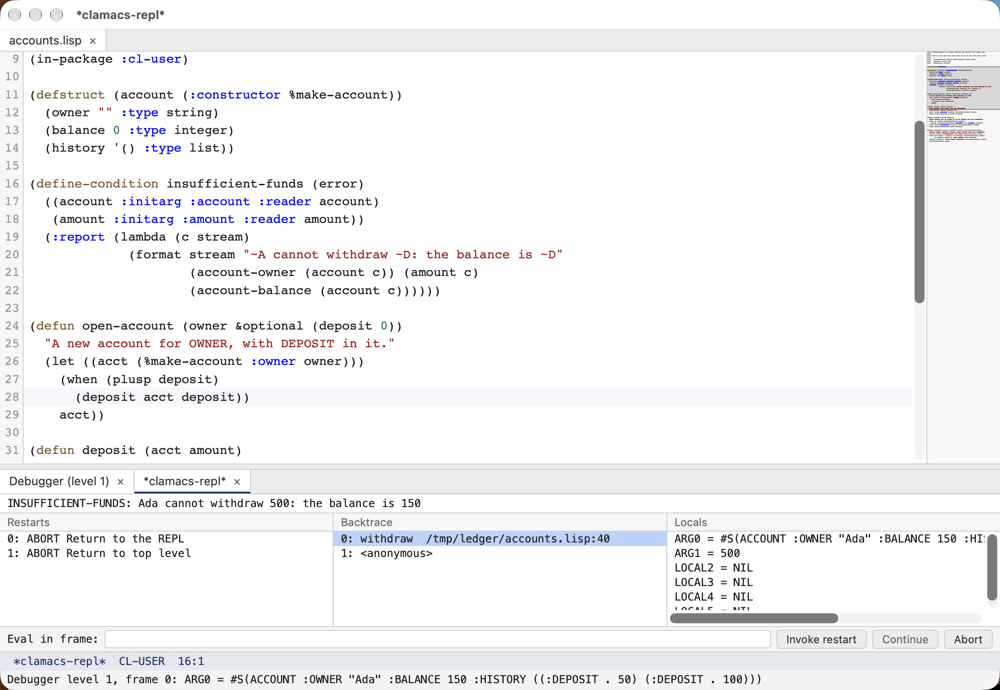

`C-c I` on `*acct*` opens the Inspector panel with the structure's parts:

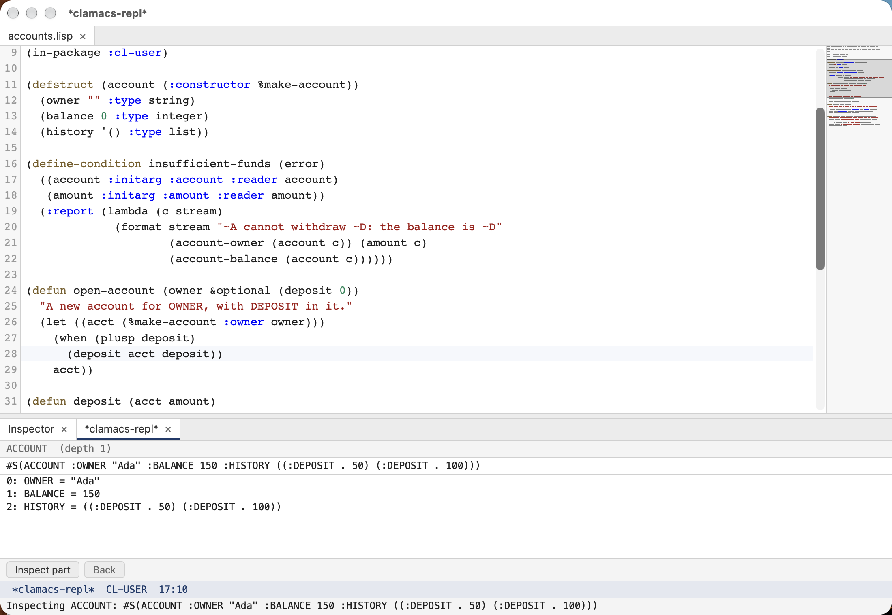

`C-c C-k` on a file with two mistakes fills the Diagnostics panel, and
``C-x ` `` puts the cursor on the first one with its message in the echo
area:

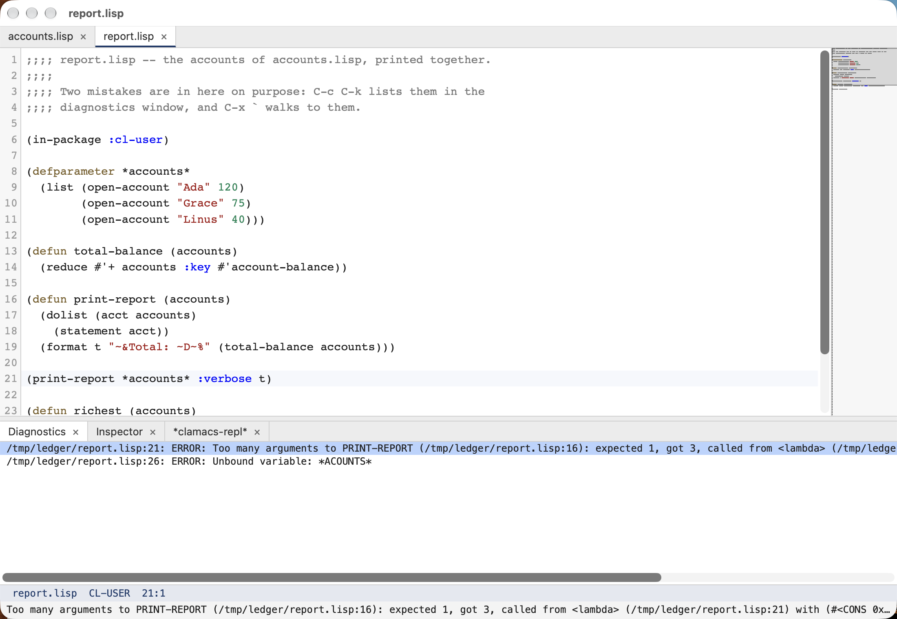

The One Dark theme (View > Themes), and `M-x clamacs-eval` TAB with its
candidates listed above the status line:

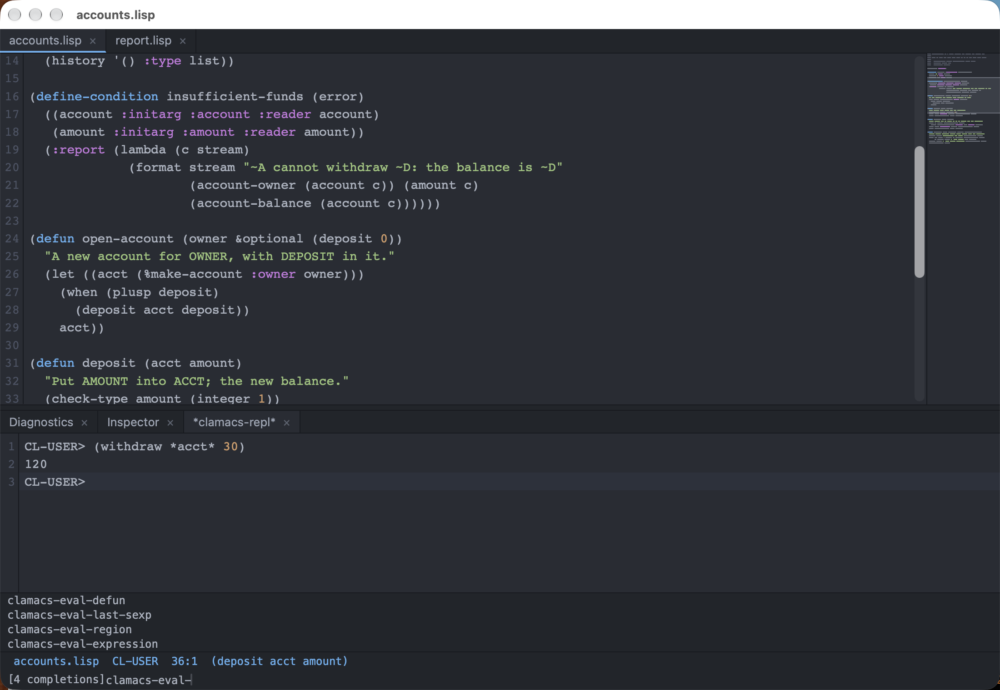

## Requirements

### AmigaOS and MorphOS

- An AmigaOS 3 machine with a 68020 or better, or a MorphOS machine,
  with the AmiLisp binary release installed (Clamacs ships inside it).
- **MUI 3.8 or newer** (`muimaster.library` 19+).
- **TextEditor.mcc 15.29 or newer** in `MUI:Libs/mui/`.  MorphOS ships
  it; on AmigaOS 3 install it from Aminet if it is missing.  The editor
  checks at startup and reports a missing or too old class in a
  requester, naming the installed version and the one needed.
  Verified against MUI 3.8 and TextEditor.mcc 15.56.
- Optional: `openurl.library` (part of MorphOS; on AmigaOS 3 the
  [OpenURL](https://github.com/jens-maus/libopenurl) package, Aminet
  `comm/www/OpenURL.lha`).  Help > Common Lisp HyperSpec uses it to open
  your browser; without it the editor shows the address in a requester
  instead.

### macOS and Linux

- A checkout of AmiLisp with the `clamacs` submodule, and a built host
  `amilisp` (`make host` in the superproject).
- macOS: nothing else; `make host-app` in the submodule builds a
  `Clamacs.app` you can keep in the Dock.
- Linux: GTK 3 and WebKitGTK 4.1 (see [docs/developing.md](docs/developing.md)
  for the packages).
- Windows is not supported yet.

## Starting the editor

### From the binary release on AmigaOS and MorphOS

Double-click the **Clamacs** icon in the release drawer (**Clamacs-FPU**
for the hard-float build, **Clamacs-MOS** on MorphOS).  The icon runs
the editor from its heap image, which is this shell line:

```
amilisp --image clamacs.img --non-interactive --eval "(clamacs::run)" -- file.lisp ...
```

Files to open come after the `--`; without any, one unnamed Lisp buffer
opens.  A bare argument *before* the `--` is something for amilisp to
load, not a file to edit.

### From a checkout

```
amilisp --heap 8M --non-interactive --load Clamacs:lisp/clamacs.lisp -- file.lisp ...
```

This loads the editor from its sources (a FASL beside a source file is
used when it is not older than the source).

### On macOS and Linux

```
host/run.sh file.lisp ...        # builds what is missing, then starts the editor from source
IMAGE=1 host/run.sh file.lisp    # the same from its heap image (made and verified on first use)
make host-app                    # macOS: build/host-frontend/Clamacs.app
open -a build/host-frontend/Clamacs.app --args file.lisp
```

The application bundle is not signed, and files dropped on its icon are
not opened (a shell launcher gets no Apple Events): open them from
inside the editor.

### The first start

The editor comes up with the files named on the command line, or one
empty, unnamed Lisp buffer.  The first time a command needs amilisp
(`C-c C-c`, say) the editor offers to start one; say yes, and you are
ready.  See [Connecting](#connecting) for the details and for using an
amilisp you started yourself.

## A first session

1. Start the editor and open a file with `C-x C-f` (type the name in
   the minibuffer; TAB completes).  A name no file has yet opens a new
   buffer under that name.
2. Type a definition.  RET indents the new line as Lisp, TAB re-indents
   the current one, and the matching paren lights up as you close a
   list.
3. With the cursor inside the definition press `C-c C-c` (Eval Defun).
   The first time, the editor offers to start an amilisp and connect to
   it.  The form is evaluated there; the value shows in the echo area
   at the bottom of the window, and the `*clamacs-repl*` window opens
   with a `; Evaluated:` note in its transcript.
4. Press `C-c C-z` to go to the REPL window and type a form at the
   prompt.  RET sends it once the parens balance; `M-p` brings back an
   earlier input.
5. Evaluate something that signals an error, `(car 1)` for instance.
   The debugger window opens with the condition, its restarts and the
   backtrace.  Click a frame to see its locals; double-click a restart
   to take it, or press Abort to get back to the prompt.
6. Save the buffer with `C-x C-s` and load the whole file with
   `C-c C-k` (Load Buffer).  Errors in the file become rows in the
   diagnostics window; ``C-x ` `` takes you to the first one.
7. Put the cursor on a function name and press `M-.` to jump to its
   definition, `M-,` to come back.  `C-c C-d d` describes the symbol,
   `M-TAB` completes it (on MUI: `ESC TAB` or `C-M-i`).
8. `C-x C-c` quits, asking about every unsaved buffer.

## The editor window

A document window is the text area with, below it, the status line and
the echo area.  On the Amiga every buffer is a window of its own, and
so are the REPL, the debugger, the inspector and the diagnostics.  On
the host the editor is one window: the buffers are tabs, and the tools
live in a dock below the text (see
[The host editor in detail](#the-host-editor-in-detail)).

### The status line

```
*ledger.lisp [sento]  LEDGER  12:4  (make-account name &key balance)
```

From left to right: a `*` while the buffer has unsaved changes, the
buffer's name, the project in brackets (while a project is in front;
nothing in the scratch set), the package of the form at the cursor (the one evaluations
and lookups are made in), the line and column, and the arglist of the
operator the cursor is inside, fetched from amilisp while you type.

### The echo area and the minibuffer

The bottom line shows messages (the value of an evaluation, "Loading
...", a pending prefix key such as `C-x -`) and turns into the
**minibuffer** when a command asks for something: a file name, a line
number, a command name, a form, a search pattern.

At any prompt:

| Key | Description |
|-----|-------------|
| `RET` | Accept the input |
| `C-g`, `ESC` | Abandon the prompt |
| `TAB` | Complete as far as it goes; TAB again cycles through the candidates |
| `<down>`, `<up>` | Move through the candidates TAB offered; with none on offer, walk the prompt's history |
| `M-n`, `M-p` | The next and the previous input from the prompt's history |

TAB puts the common prefix in the line and names the candidates in the
echo row; on the host they appear as a list above the status line
instead, where a click puts a row into the line and a double click takes
it.  When no candidate *starts* with what you typed, the ones that
*contain* it are offered: `eval-` finds `clamacs-eval-defun` and its
kin.  At a file prompt, TAB on an empty line or on a bare directory
opens the file requester there.

### Menus

Every menu item names a command, so the menu and `M-x` are two doors to
the same thing; the key is shown beside each item.  An item is dimmed
when it cannot apply (Save with nothing changed, Next Error with no
diagnostics, the REPL commands outside the REPL window, the Lisp
commands while no amilisp is connected).

| Menu | Description |
|------|-------------|
| **File** | New File, Open File..., Open File in New Window..., Save File, Save File As..., Next Buffer, Close Buffer, About..., Quit |
| **Edit** | Undo, Redo, Cut, Copy, Paste, Paste Previous, Select All, Search Forward..., Search Backward..., Go to Line..., Edit Occurrences, Run Command... |
| **Lisp** | Indent Line, Indent Region, Beginning/End of Defun, Complete Symbol, Show Arglist, Describe Symbol..., Apropos..., Edit Definition, Back from Definition, Macroexpand Once, Macroexpand All |
| **ASDF** | Load System, Load System From..., Test System (not shown on a 68k Amiga, where ASDF is more than most machines can carry; the commands are still there for `M-x`) |
| **AmiLisp** | Connect, Start amilisp, Talk to the Editor Itself, Talk to amilisp, Load Buffer, Load File..., Compile File, Eval Defun, Eval Last Sexp, Eval Region, Eval Expression..., Interrupt, Show Errors, Next Error, Previous Error |
| **Windows** | REPL, Inspect..., Debugger, Editor Memory, Clear Transcript, Previous/Next Input, Other Window, Snapshot Windows |
| **View** | Bigger Text, Smaller Text, Normal Text Size, Themes (submenu), Minimap (host only), Block Cursor |
| **Project** | Open Project..., Recent Projects (submenu), Close Project, Switch Project..., Next/Previous Project, Move Buffer to Project..., then one item per open project |
| **Buffers** | One item per open buffer: your files first, then the editor's own tool buffers (`*clamacs-repl*`, `*clamacs-description*`, ...); the active one is ticked |
| **Help** | List Commands, Common Lisp HyperSpec... |

Menu items whose key prompts in the minibuffer (Open File..., Save File
As..., Load File...) open the file requester when picked with the mouse
instead, as Emacs's File menu does.

## Keys

The keys are Emacs's.  Anything *not* bound by the editor goes to the
text widget as it is, which is how the arrows, Home and End, Backspace,
mouse selection and plain typing work.

### Notation

| Notation | Description |
|----------|-------------|
| `C-x` | Hold Control and press x |
| `M-x` | Hold Meta and press x.  Meta is the Alt key on the Amiga and on Linux, the Option key on the Mac.  `ESC` followed by the key works everywhere, so `ESC x` is `M-x` |
| `C-M-f` | Control and Meta together |
| `C-x C-f` | A key sequence: `C-x`, then `C-f`.  The echo area shows the pending prefix |
| `RET`, `TAB`, `DEL`, `BS`, `SPC` | Return, Tab, Delete, Backspace, Space |
| `C-u` | The numeric argument prefix, see below |

On the Amiga and MorphOS the two Alt keys differ: the left Alt is Meta,
the right Alt alone types the keymap's Alt level (on a German MorphOS
keymap Alt-Shift-U-umlaut is `{`), both together are Meta over that
character, and with Control either Alt is Meta.  On the Mac the left
Option is Meta and the right Option composes the layout's character.
The platform's own keys for cut, copy and paste (right Amiga-X, -C, -V;
Command-X, -C, -V) work too and know the kill ring.

On MUI, Alt-TAB is the toolkit's own Next Window key and never reaches
the editor, so there `complete-symbol` is `ESC TAB` or `C-M-i`, the key
the menu shows.

### The numeric argument

`C-u` before a command repeats it or changes what it does, as in Emacs:
`C-u` alone is 4, `C-u C-u` is 16, `C-u 1 2` is 12, `C-u -` negates.
`M-1` ... `M-9` and `M--` start an argument without `C-u`.  `C-u 5 C-n`
moves down five lines; `C-u C-;` edits every occurrence in the whole
buffer rather than in the current defun; `C-u` before a View setting
(a theme, the text size, the minimap, the cursor) keeps the change to
this session instead of writing it into the init file.

### Running commands by name

`M-x` (Edit > Run Command...) asks for a command name with completion;
TAB on an empty line says how many commands there are.  **Help > List
Commands** (`M-x clamacs-list-commands`) opens a window listing every
command with its keys and a one-line description, the commands from
your init file included.  The tables below are that listing, grouped.

### Moving around

| Key | Command | Description |
|-----|---------|-------------|
| `C-f`, `C-b` | forward-char, backward-char | One character forward, back |
| `C-n`, `C-p` | next-line, previous-line | Down, up one line |
| `C-a`, `C-e` | beginning-of-line, end-of-line | Start, end of the line |
| `M-f`, `M-b` | forward-word, backward-word | One word forward, back |
| `M-<`, `M->` | beginning-of-buffer, end-of-buffer | Start, end of the buffer |
| `C-v`, `M-v` | scroll-up, scroll-down | One page down, up |
| `C-l` | recenter | Repaint the window and recolour the whole buffer |
| `M-g g` | goto-line | Go to a line by its number |
| `C-s`, `C-r` | isearch-forward, isearch-backward | Incremental search forward, backward |

### Editing text

| Key | Command | Description |
|-----|---------|-------------|
| `C-d` | delete-char | Delete the character after the cursor |
| `M-d` | kill-word | Kill to the end of the word |
| `M-DEL`, `M-BS` | backward-kill-word | Kill back to the start of the word |
| `C-k` | kill-line | Kill to the end of the line (the newline when at the end) |
| `C-w` | kill-region | Cut the region onto the kill ring |
| `M-w` | kill-ring-save | Copy the region onto the kill ring |
| `C-y` | yank | Paste the last kill, or what another application copied |
| `M-y` | yank-pop | After `C-y`: replace the pasted text with the kill before it |
| `C-SPC` | set-mark-command | Set the mark; the region is from here to the cursor |
| `C-x C-x` | exchange-point-and-mark | Swap the cursor and the mark |
| `C-x h` | mark-whole-buffer | Select the whole buffer |
| `C-/`, `C-_`, `C-x u` | undo | Undo the last edit |
| `C-x r` | redo | Redo the last undone edit |
| `C-;` | clamacs-iedit | Edit every occurrence of the symbol at point at once |
| `C-g` | keyboard-quit | Drop the mark and the selection, abandon a prompt or a prefix key |

### Files, buffers and windows

| Key | Command | Description |
|-----|---------|-------------|
| `C-x C-f` | find-file | Open a file (a new buffer for a new name) |
| `C-x 2` | find-file-other-window | Open a file in a window of its own |
| `C-x C-s` | save-buffer | Save the buffer (asks for a name when it has none) |
| `C-x C-w` | write-file | Save the buffer under another name |
| `C-x b` | switch-to-buffer | Go to the next buffer |
| `C-x o` | other-window | Activate the next window |
| `C-x k` | kill-buffer | Close the buffer and its window, asking about unsaved changes |
| `C-x C-c` | save-buffers-kill-emacs | Quit, asking about every unsaved buffer |
| `M-x` | execute-extended-command | Run a command by name |
| `C-x C-+`, `C-x C-=` | clamacs-increase-font-size | Bigger text |
| `C-x C--` | clamacs-decrease-font-size | Smaller text |
| `C-x C-0` | clamacs-reset-font-size | Normal text size |

### Lisp mode

These keys are active in a Lisp buffer (`.lisp`, `.lsp`, `.cl`, `.asd`,
and every unnamed buffer) and in the REPL window.

| Key | Command | Description |
|-----|---------|-------------|
| `TAB` | indent-for-tab-command | Indent the current line as Lisp |
| `RET` | newline-and-indent | Insert a newline and indent it |
| `C-M-\` | indent-region | Indent every line of the region |
| `C-M-f`, `C-M-b` | forward-sexp, backward-sexp | Over the next, the previous balanced expression |
| `C-M-u` | backward-up-list | Up out of the enclosing list |
| `C-M-d` | down-list | Down into the next list |
| `C-M-a`, `C-M-e` | beginning-of-defun, end-of-defun | Start, end of the top-level form |
| `C-M-k` | kill-sexp | Kill the balanced expression after the cursor |
| `M-(` | insert-parentheses | Insert `()` and put the cursor between them |

### Talking to amilisp

| Key | Command | Description |
|-----|---------|-------------|
| `C-c C-c` | clamacs-eval-defun | Evaluate the top-level form at the cursor |
| `C-x C-e` | clamacs-eval-last-sexp | Evaluate the expression before the cursor |
| `C-c C-r` | clamacs-eval-region | Evaluate the region |
| `C-c C-e` | clamacs-eval-expression | Evaluate a form typed in the minibuffer |
| `C-c C-k` | clamacs-load-buffer | Save the buffer and LOAD its file |
| `C-c C-l` | clamacs-load-file | LOAD a file asked for in the minibuffer |
| (none) | clamacs-compile-file | COMPILE-FILE the buffer's file and list the diagnostics |
| `C-c C-b` | clamacs-interrupt | Interrupt what the REPL thread is evaluating |
| `C-c C-z` | clamacs-repl | Open or raise the REPL window |
| `C-c I` | clamacs-inspect | Evaluate a form and inspect its value |
| `C-c ! l` | clamacs-show-errors | Show the diagnostics of the last load or compile |
| ``C-x ` ``, `C-x ~` | clamacs-next-error, clamacs-previous-error | Go to the next, the previous diagnostic |
| `M-TAB`, `C-M-i` | complete-symbol | Complete the symbol before the cursor |
| (none) | clamacs-arglist | Show the arglist of the function at the cursor |
| `M-.` | clamacs-edit-definition | Jump to the definition of the symbol at the cursor |
| `M-,` | clamacs-pop-definition | Back to where the last jump started |
| `C-c C-d d`, `C-c C-d C-d` | clamacs-describe-symbol | Describe a symbol in a window |
| `C-c C-d a`, `C-c C-d C-a` | clamacs-apropos | List the symbols whose names contain a string |
| `C-c RET`, `C-c C-m` | clamacs-macroexpand-1 | Expand the macro form at the cursor once |
| `C-c M-m` | clamacs-macroexpand | Expand it fully |
| (none) | clamacs-connect | Find amilisp's port and connect; offer to start one when there is none |
| (none) | run-lisp | Start an amilisp of the editor's own and connect to it |
| (none) | clamacs-load-system, clamacs-test-system, clamacs-load-system-from | Load or test the buffer's ASDF system |

### REPL window keys

In the REPL window these keys replace the Lisp-mode ones; everything
else from the Lisp map works there too.

| Key | Command | Description |
|-----|---------|-------------|
| `RET` | clamacs-repl-return | Send the input, or add a line while the form is unfinished |
| `M-p`, `M-n` | clamacs-repl-previous-input, clamacs-repl-next-input | Walk the input history |
| `C-c C-c`, `C-c C-b` | clamacs-interrupt | Interrupt the running form |
| `C-c M-o` | clamacs-repl-clear | Clear the transcript, keeping the prompt |

### Project keys

| Key | Command | Description |
|-----|---------|-------------|
| `C-x p o` | clamacs-project-open | Open a project (a folder or its `.asd`) |
| `C-x p p` | clamacs-project-switch | Switch to a project by name |
| `C-x p n`, `C-x p N` | clamacs-project-next, clamacs-project-previous | The next, the previous open project |
| `C-x p k` | clamacs-project-close | Close the project in front |
| `C-x p a` | clamacs-project-move-buffer | Move this buffer into another project |

### Inside an edit-occurrences session

While `C-;` is on, these keys belong to the session.

| Key | Command | Description |
|-----|---------|-------------|
| `M-n`, `M-p` | clamacs-iedit-next, clamacs-iedit-previous | The next, the previous occurrence |
| `M-;` | clamacs-iedit-toggle-occurrence | Drop the occurrence at point out of the set |
| `M-{`, `M-}` | clamacs-iedit-expand-up, clamacs-iedit-expand-down | Widen the scope by one line at the top, at the bottom |
| `M-H` | clamacs-iedit-restrict-defun | Narrow the scope to the cursor's defun |
| `C-;`, `C-g` | | End the session |

## Editing

### Files and buffers

**Opening.** `C-x C-f` (File > Open File...) asks for a file name in the
minibuffer.  TAB completes against the directory typed so far; on an
empty line or a bare directory it opens the file requester there
instead.  A name no file has yet opens an empty buffer under that name,
as in Emacs, and `C-x C-s` creates the file (offering to create a
missing directory too).  **File > New File** opens an empty, unnamed
Lisp buffer.  `C-x 2` opens a file in a window of its own; on the Amiga
every buffer is a window anyway, on the host this makes a new tab.
A file that is already open in another project is brought over rather
than opened twice.

**Saving.** `C-x C-s` saves; `C-x C-w` (Save File As...) saves under
another name, which the buffer takes from then on.  Closing a changed
buffer or quitting asks what to do with it: Save, Discard or Cancel.

**Lisp mode** (colouring, paren matching, indentation, the Lisp keys)
follows the file name: `.lisp`, `.lsp`, `.cl` and `.asd` files and
every unnamed buffer are in Lisp mode; anything else is a plain text
buffer with the global keys only.

**Switching.** `C-x b` and `C-x o` go to the next buffer; the
**Buffers** menu lists every open buffer, the active one ticked, your
files first and the editor's tool buffers (the REPL, descriptions,
apropos results) below a separator.  When two files share a name each
entry shows its directory.  The window's title bar shows the file's
full path.

### Selection, cut, copy and paste

The region runs from the mark (`C-SPC`) to the cursor and is shown
selected; so is what you select with the mouse or with Shift and a
cursor key.  `C-g` takes the selection down.  `C-w` cuts and `M-w`
copies the region; `C-k`, `M-d` and `C-M-k` kill too, and a run of
kills in a row joins into one entry.  Every kill goes to the kill ring
*and* to the system clipboard, so other applications see it.  `C-y`
pastes the last kill, or what another application copied; `M-y` right
after it reaches the earlier kills.  The platform's own keys (right
Amiga-X, -C, -V on the Amiga; Command-X, -C, -V on the Mac) do the same
through the same commands.  On the host, typing replaces a selection
made with the mouse or Shift, and Option or Control with the left and
right arrows moves by the word.

### Undo

`C-/` (also `C-_` and `C-x u`) undoes the last edit, `C-x r` redoes it.
Undo is not available in the REPL window, whose transcript is not a
file.

### Search

`C-s` starts an incremental search: the minibuffer shows `I-search:`
and the cursor moves to the first match as you type; `C-s` again finds
the next, `C-r` the previous (`C-r` starts a backward search).  `RET`
leaves the cursor at the match; `C-g` or `ESC` goes back to where the
search started.  Edit > Go to Line... (`M-g g`) asks for a line
number.

### Lisp editing

**Indentation.** `RET` inserts a newline and indents it as Lisp; `TAB`
re-indents the current line; `C-M-\` indents every line of the region.
The indenter knows the standard special forms and macros (`let`,
`defun`, `when` and their kin indent their bodies by two).

**Balanced expressions.** `C-M-f` and `C-M-b` move over an expression,
`C-M-u` and `C-M-d` move out of and into a list, `C-M-a` and `C-M-e`
jump to the start and end of the top-level form, `C-M-k` kills the
expression after the cursor and `M-(` inserts a pair of parentheses
with the cursor between them.

**Paren matching and colouring.** The partner of the paren before the
cursor is lit, and the text is coloured by token: comments, strings,
numbers, keywords, defining forms, symbols.  Both follow the typing
rather than every single key: the characters appear first, the colours
and the highlight catch up once the keys rest for a moment.  The
scanners start at the cursor's defun, the nearest `(` in column 0 above
it, so, as in Emacs, a `(` in column 0 inside a string or a comment is
best indented or escaped.  On a slow machine both can be switched off,
see [Syntax colouring and paren matching](#syntax-colouring-and-paren-matching).

### Editing every occurrence at once

`C-;` on a symbol (Edit > Edit Occurrences) marks every occurrence of
it in the current defun, or in the whole buffer when the defun holds it
only once (a function's name on its `defun` line, say); `C-u C-;`
always takes the whole buffer.  From then on whatever you do inside the
occurrence under the cursor happens in all of them: typing, Backspace,
Delete, `M-d`, `C-y`.  That is how a parameter or a local is renamed.
Every whole symbol counts, in code, in a string or in a comment, so a
docstring's mention of the parameter follows the rename; `foobar` never
matches `foo`, and `FOO` is `foo`, as it is to the reader.

While the session is on, `M-n` and `M-p` move between the occurrences,
`M-;` drops the one at point out of the set, `M-{` and `M-}` widen the
scope by one line at the top and at the bottom, `M-H` narrows it to the
cursor's defun again, and undo takes an edit back in all of them.
`C-g` or `C-;` ends the session, as does an edit that adds or removes a
line.  Outside Lisp mode the same keys edit every whole word.  This is
Emacs's iedit.

## Working with amilisp

The editor is itself an amilisp, but the Lisp you load into, evaluate in
and debug is a separate one.  The **AmiLisp** menu manages it.

### Connecting

**Connect** (`M-x clamacs-connect`) looks for a running amilisp's port
and attaches to it, and offers to start one when there is none.
**Start amilisp** (`M-x run-lisp`) starts one on the binary the editor
runs on and connects to it; the first `C-c C-c` makes the same offer.
When amilisp was restarted, the next evaluation finds the new one and
attaches the REPL again by itself; the echo area says where it was
found.

An amilisp the editor starts runs headless, with its own console window
for what it prints (on the Amiga) or a log file (on the host), and is
stopped when the editor quits.  An amilisp you started yourself is left
running.  Its heap and command line options come from the init file,
see [The amilisp the editor starts](#the-amilisp-the-editor-starts).

**To use an amilisp you start yourself** on the Amiga, have it open its
ARexx port:

```lisp
(require "amiga/arexx")
(amiga.arexx:start)      ; port AMILISP; a second instance takes AMILISP.1, ...
```

Put the two lines in `S:.amilisprc` to have every amilisp open the
port, or type them at its prompt.  The editor scans `AMILISP`,
`AMILISP.1`, ... (and the pre-0.12 names `CLAMIGA`, `CLAMIGA.1`, ...).

On the host the wire is TCP: start the port with

```lisp
(require "dev-tcp")
(ext.dev.tcp:start)                      ; 127.0.0.1:4005, token drawn and printed once
(ext.dev.tcp:start :port 4005 :token "...")
(ext.dev.tcp:start :host "192.168.1.5")  ; reachable from the LAN, on this one address
```

and name it to the editor through its environment:
`CLAMACS_AMILISP=host:port` (default `127.0.0.1:4005`) and
`CLAMACS_AMILISP_TOKEN=...`.  The token authenticates; nothing is
encrypted.  An Amiga on the LAN works too, when its port was started
with `:host` and the editor with `--bind` (see
[The TCP port](#the-tcp-port-on-macos-and-linux)).

### Evaluating code

`C-c C-c` (Eval Defun) evaluates the top-level form around the cursor,
`C-x C-e` (Eval Last Sexp) the expression before the cursor, `C-c C-r`
(Eval Region) the region and `C-c C-e` (Eval Expression...) a form you
type in the minibuffer.  Every form runs in the package of the buffer
(the `in-package` above the cursor, shown in the status line) on
amilisp's REPL thread, as under SLIME:

- what the form prints goes to the `*clamacs-repl*` transcript;
- its values go to the echo area and, as a `; Evaluated: ...` line
  above the prompt, into the transcript;
- an error opens the debugger window with the erring stack still there.

The REPL window is opened and attached the first time you evaluate.
`C-c C-b` (Interrupt) stops a form that runs too long.

A buffer whose package amilisp does not have yet (its system not
loaded) is told so once in the echo area; the form is evaluated once
something defined the package.

### Loading and compiling files

`C-c C-k` (Load Buffer) saves the buffer and LOADs its file; `C-c C-l`
(Load File...) asks for a file.  The load runs on the REPL thread like
an evaluation: whatever the file prints streams into the transcript
under a `; loading ...` line, and `C-c C-b` interrupts it.  Unlike an
evaluation, an error in the file does *not* open the debugger: every
error becomes a row in the diagnostics window, the load goes on with
the next form, and a summary ends the transcript's account.

**Compile File** (`M-x clamacs-compile-file`, no key) runs
`compile-file` on the buffer's file and lists what the compiler had to
say in the diagnostics window.

### Diagnostics

Errors and warnings from a load or a compile are collected in the
diagnostics window (on the host, the Diagnostics panel in the dock),
one row per message with the file and line.  A click on a row puts the
cursor on that line, with the message in the echo area; ``C-x ` ``
(Next Error) and `C-x ~` (Previous Error) walk the rows from the
keyboard, and `C-c ! l` (Show Errors) brings the window back.

### The REPL window

`C-c C-z` (Windows > REPL) opens or raises `*clamacs-repl*`, a listener
fed by a REPL thread in amilisp.  The transcript above the prompt is
history; the text after the prompt is your input.

- `RET` sends the input when its parens balance and inserts a newline
  otherwise, so a `defun` can be typed over several lines.
- `M-p` and `M-n` walk the input history.
- `C-c C-c` or `C-c C-b` interrupts the running form; `C-c M-o` clears
  the transcript.
- The prompt shows the current package; `(in-package ...)` typed at
  the prompt moves it.  A buffer evaluation runs in its buffer's
  package and leaves the prompt alone.
- A form that reads from standard input (`read-line`) takes its input
  from the line you type next.
- Typing while the cursor is in the transcript lands in the input;
  `C-a` on the prompt line stops after the prompt.  Undo is not
  available.
- `*` holds the last value as usual, so `C-c I *` inspects the last
  result.

The window's title names the project in front, and a switch to another
project makes that project's folder amilisp's default directory (noted
in the transcript), so a relative path typed at the prompt means the
project's.

When amilisp runs out of heap, its REPL thread ends: `C-c C-c` then
says so and names the log of the started amilisp, and `C-c C-z` attaches
a new REPL thread.

### The debugger

An unhandled error in a form evaluated from a buffer or typed at the
prompt does not end the form: amilisp's REPL thread stays on the erring
stack and the debugger window opens (on the host, the Debugger panel):

- **the condition**, its type and report;
- **Restarts**: double-click one, or select it and press **Invoke
  restart**, to take it.  **Continue** takes the `CONTINUE` restart
  when there is one; **Abort** leaves the debugger and returns to the
  prompt;
- **Backtrace**: selecting a frame shows its **locals**; a double-click
  opens the frame's source line in a buffer when amilisp knows it;
- **Eval in frame:** a line whose form is evaluated in the selected
  frame, with its locals in scope; the values go to the REPL
  transcript.

An error inside an eval-in-frame nests one level deeper, and the window
follows the levels.  The buttons exist as commands too, prompting for
their number, so the debugger can be driven without a mouse:
`M-x clamacs-debugger` raises the window, `clamacs-debugger-restart`,
`clamacs-debugger-frame`, `clamacs-debugger-eval`,
`clamacs-debugger-continue` and `clamacs-debugger-abort` do the rest.

### The inspector

`C-c I` (Windows > Inspect...) asks for a form, evaluates it in amilisp
and opens the inspector window (on the host, the Inspector panel) on its
value: the object and its numbered parts, slots for a structure or an
instance, elements for a list or a vector, and so on.  A double-click on
a part descends into it; **Back** comes up one level.
`M-x clamacs-inspector-part` and `clamacs-inspector-pop` do the same by
number.  The form is evaluated with the REPL's `*` in scope, so
`C-c I *` looks at the last REPL value.

### Looking things up

- **Arglist.** While you type inside a call, the status line shows the
  argument list of the operator the cursor is in, fetched quietly from
  amilisp.  **Lisp > Show Arglist** (`M-x clamacs-arglist`) shows it in
  the echo area on demand.
- **Completion.** `M-TAB` (`C-M-i`; on MUI `ESC TAB`) completes the
  symbol before the cursor with the candidates amilisp knows; when none
  starts with the text, the names that contain it are offered.
- **Describe and apropos.** `C-c C-d d` describes the symbol at the
  cursor in the `*clamacs-description*` window; `C-c C-d a` asks for a
  string and lists every symbol whose name contains it in
  `*clamacs-apropos*`.
- **Definitions.** `M-.` jumps to the definition of the symbol at the
  cursor, opening its file when needed; `M-,` goes back to where the
  jump started, as many levels as you went.
- **Macroexpansion.** `C-c RET` expands the macro form at the cursor
  once, `C-c M-m` fully, each in a window of its own.
- **The HyperSpec.** Help > Common Lisp HyperSpec opens the standard in
  your browser.

### ASDF systems

The **ASDF** menu loads whole systems.  **Load System** (`M-x
clamacs-load-system`) takes the `.asd` in the window, or the nearest one
in the directories above the window's file (a project's root is where
its `.asd` sits), has amilisp load ASDF the first time, then the system
named after the file with everything it depends on that is not loaded
yet.  A second Load System compiles what changed and nothing else.  A
file that defines several systems (`foo` and `foo/tests`, say) asks
which one in a requester.  **Test System** runs `asdf:test-system`, and
**Load System From...** asks for the `.asd`.  The REPL window, having no
system of its own, takes the last one loaded.

This runs on the REPL thread like an evaluation: the compiler's output
streams into the transcript, `C-c C-b` interrupts and an error opens
the debugger.  On a 68k Amiga the menu is left out, since ASDF is more
than most of them can carry; the commands are still there for a machine
with the memory.

### Talking to the editor itself

**AmiLisp > Talk to the Editor Itself** (`M-x clamacs-connect-self`)
points everything, the REPL window, the debugger and inspector,
arglist, completion, describe, apropos, `M-.` and loading, at the
editor's own Lisp instead of at amilisp.  Redefine one of the editor's
functions at that prompt, or load one of its source files, and the
running editor has it.  Forms run on a thread of their own, so `C-c
C-c` interrupts them and an error opens the debugger; wrap anything
that touches a window or a buffer in `clamacs:in-editor`, which runs it
on the editor's own task:

```lisp
(clamacs:in-editor
  (clamacs::doc-name (clamacs::editor-active-document clamacs::*editor*)))
```

**AmiLisp > Talk to amilisp** switches back.  **Windows > Editor
Memory** (`M-x clamacs-room`) shows the editor's heap next to the
system's free memory.

## Projects

A project is a folder.  Open one, and the files you open from then on
belong to it; switch to another, and the first project's windows are
hidden while the second's are shown.  The one REPL and the editor's tool
buffers are shown in every project.

### Opening and switching

**Project > Open Project...** (`C-x p o`) asks for a folder or its
`.asd` at the prompt, seeded with your home directory (`HOME` or `SYS:`
on the Amiga).  TAB completes the path; TAB on a bare directory opens
the folder requester there, and so does `RET` on an empty line.  The
project is named after the one `.asd` in the folder (`sento` for
`Work:sento/sento.asd`), else after the folder, and the editor switches
to it.

The open projects are listed at the bottom of the Project menu, the one
in front ticked, with `(no project)` above them while there are buffers
that belong to none (the buffer the editor started with, say).
**Switch Project...** (`C-x p p`) does the same by name with
completion; `C-x p n` and `C-x p N` go to the next and the previous
one.  `C-x p a` (Move Buffer to Project...) moves the current buffer
into another project, or out of any.

### Closing and recent projects

**Close Project** (`C-x p k`) closes the project's buffers, each
unsaved one asking, and moves the project to **Recent Projects**, a
submenu of the projects the editor knows and has no windows for.
Picking one there, or naming it at `C-x p p`, opens it again with the
files it had.  Closing the last buffer of a project brings another
project with buffers in front, so a window is always on the screen.

### What a project changes

- The **Buffers** menu and `C-x o` see only the project's buffers.
- In a buffer without a file, the file prompt and the requester start
  in the project's folder, and the ASDF commands look for the `.asd`
  there.
- A switch makes the folder amilisp's default directory (an open REPL
  notes it), so a relative path at the REPL means the project's.
- The status line and the REPL window's title show the project's name
  in brackets after the buffer's name, while a project is in front
  (nothing in the scratch set).
- A file already open in another project is brought over by `C-x C-f`
  rather than opened twice; the echo area says from where.

### The projects file

The editor remembers the projects on its own, in
`ENVARC:Clamacs/projects.cfg` (and `ENV:`) on the Amiga and
`~/.clamacs-projects.cfg` on the host, kept in step whenever a project
is opened or closed and at every quit.  The next start opens nothing of
theirs: the editor comes up with the files named on the command line,
else an empty buffer, and every project is in Recent Projects with its
folder and its files, one pick away.

The file is plain text: one `project NAME` line followed by its `root`
and `file` lines.  To forget a project, quit the editor, delete its
lines (on the Amiga from both `ENVARC:` and `ENV:`) and start again;
the editor rewrites the file at every quit, so an edit made while it
runs is lost.  Delete the file to start over.  `M-x
clamacs-project-restore` reopens every project of the file at once,
`M-x clamacs-project-rename` renames the one in front.

## Appearance

The View menu's settings are remembered in your init file: picking one
writes a single form there (`(load-theme :one-dark)`, `(font-size
20)`, ...) and touches nothing else.  `C-u` before the key or the `M-x`
command keeps a change to this session instead.

### Themes

**View > Themes** lists the colour themes, the one in effect ticked:
Light and Dark (the editor's own two looks; the one the system's
appearance calls for is the default), Solarized Light, Solarized Dark,
One Dark and Gruvbox Dark.  `M-x clamacs-theme` picks one by name with
completion.

A theme of your own is a `define-theme` form in the init file, naming a
built-in to start from and the colours to change:

```lisp
(define-theme :my-dark (:inherits :one-dark :label "My Dark")
  :keyword "#ff9900" :font-size "15px")
(load-theme :my-dark)
```

The keys are the text (`:bg :fg :dim :cursor :selection :active-line`),
the occurrence marks (`:occurrence :occurrence-current`), the gutter
(`:gutter-bg :gutter-fg`), the chrome (`:bar :bar-fg :tab-active :line
:status-bg :status-fg :echo-bg :echo-fg`), the tokens (`:comment
:string :number :keyword :defining :symbol :paren-match :paren-bad`)
and the font (`:font-family :font-size`); a colour is `#rrggbb`.  A
misspelt key or colour is reported with the file's line, and a
`load-theme` of a name that is not defined falls back to the default
with a message, so the editor always comes up.

On the host every key is honoured.  On the Amiga the text area takes
the theme's text, background and token colours in a Lisp buffer; the
cursor, the selection, the status line, the echo area and the panels
keep your MUI preferences, as does a buffer that is not in Lisp mode.
On a Workbench of 16 colours or fewer a dark theme applies its token
colours only and leaves the text and background as they are, and says
so once.

### Text size

**View > Bigger Text** and **Smaller Text** (`C-x C-+`, `C-x C--`)
change the size of the text area's font in every document window, two
pixels a step; **Normal Text Size** (`C-x C-0`) goes back to the
default.  The font stays your monospace default (MUI's fixed font on the
Amiga, the theme's `:font-family` on the host); only its height changes.
The status line, the echo area and the panels keep their own fonts.

### Minimap

On the host a source buffer has, at its right edge, the whole text in
miniature with a box over the lines that are on screen; click or drag
on it to scroll there.  **View > Minimap** (`M-x
clamacs-toggle-minimap`) shows or hides it.  The Amiga editor has no
minimap and does not show the item.

### Cursor shape

The cursor is a block the width of the character under it, on the host
as on the Amiga.  **View > Block Cursor** (`M-x
clamacs-toggle-block-cursor`) switches to a bar and back, in every text
area, the REPL's too.

### Syntax colouring and paren matching

On a slow machine either can be switched off: `M-x
clamacs-toggle-syntax-colouring` and `M-x
clamacs-toggle-paren-matching`, remembered as `(syntax-colouring nil)`
and `(paren-matching nil)` in the init file.

### Window positions

Arrange the windows, then pick **Windows > Snapshot Windows** (`M-x
clamacs-snapshot-windows`): the position and size of every open window
is written to `ENVARC:Clamacs/windows.cfg` (and `ENV:`) on the Amiga,
`~/.clamacs-windows.cfg` on the host, and the windows come up there from
then on: the REPL, the debugger, the inspector, the diagnostics, and the
file windows in the order they are opened.  The file is plain text, one
`role left top width height` line per window; edit it or delete it to
start over.  Snapshotting again only updates the windows that are open
at the time; the positions are also written at every quit.

## The init file

`S:.clamacsrc` on the Amiga, `~/.clamacsrc` on the host, is loaded
before the first window opens, in the `CLAMACS` package.  A form that
signals is reported with the file and line, and the rest of the file is
still loaded.

### Settings

The forms the View menu writes, which you can also write yourself:

```lisp
(load-theme :solarized-dark)
(font-size 18)
(show-minimap nil)
(block-cursor nil)
(syntax-colouring nil)
(paren-matching nil)
```

### Your own commands and keys

A command is a function of the document and the numeric argument; `M-x`,
the menu and the editor's port all find it by name:

```lisp
(define-command insert-date (doc arg)
  (declare (ignore arg))
  (doc-insert doc (multiple-value-bind (s m h d mo y) (get-decoded-time)
                    (declare (ignore s m h))
                    (format nil "~D-~2,'0D-~2,'0D" y mo d))))
(bind-key "C-c d" 'insert-date)            ; :global (the default), :lisp or :repl
```

The document operations available to a command are the frontend
protocol in `lisp/frontend.lisp`; `lisp/commands.lisp` is full of
examples.  `bind-key` refuses a key sequence that clashes with a binding
already there (`C-c d x` after `C-c d`, or `C-x` on its own): a key is
a command or a prefix, never both.  Binding the same keys again
replaces the earlier binding.  Help > List Commands shows your commands
with the built-in ones.

### The amilisp the editor starts

```lisp
(setq *amilisp-heap* "512M")               ; as amilisp's --heap takes it
(setq *amilisp-options* '("--no-userinit"))
```

The heap is what a loaded system and everything it depends on has to fit
in.  Without a setting it is 256M on macOS, Linux and Windows, and
amilisp's own default on an Amiga or MorphOS, where the size is yours to
choose for the machine; `(setq *amilisp-heap* nil)` asks for amilisp's
default everywhere.  On the host `CLAMACS_AMILISP_HEAP` in the editor's
environment goes before the init file.  The started amilisp loads your
`S:.amilisprc` (or `~/.amilisprc`) unless `--no-userinit` is among the
options.

The names before AmiLisp 0.12 still work: `*clamiga-heap*` and
`*clamiga-options*` set the same variables, and the `CLAMACS_CLAMIGA...`
environment variables are read when the `CLAMACS_AMILISP...` spelling is
not set.

### A note on the heap image

The heap image the release starts from keeps only the Amiga OS names the
editor uses itself.  An init file that calls the OS directly
(`amiga.raw.intuition:...`) can name one that is not in it and gets a
reader error saying the package's binding table was shed.  Loading that
module's FASL again, from the release's `lib/amiga/raw/`, brings the
whole module back; a `--no-image` start has all of them.

## Scripting the editor

The editor serves a port of its own, for macros, scripts and unattended
runs.  `EVAL <command>` runs any editor command by name, and an `EVAL`
argument starting with `(` is evaluated in the editor itself: what the
form prints comes back in front of its values, so `EVAL (room)` is
readable from a macro.  Replies are capped at 8 KB.

### The ARexx port on AmigaOS and MorphOS

The port is `CLAMACS` (a second editor takes `CLAMACS.1`, and on MUI 3.8
even the first one may come up as `CLAMACS.1`, so a macro should scan):

```rexx
address 'CLAMACS'
'EVAL (room)'                       /* the editor's own heap, as text */
say RESULT
'EVAL (clamacs:define-command hello (doc arg) (clamacs::doc-message doc "hi"))'
```

`examples/arexx/load-current-file.rexx` is a complete macro: it asks the
editor for the file in the front window, saves it and has amilisp load
it, scanning both ports.

### The TCP port on macOS and Linux

The port is a TCP listener on `127.0.0.1`, serving the same verbs on a
length-framed line protocol.  It answers nothing before `AUTH <token>`:
the session's token and the port number are in `$TMPDIR/clamacs-token`
and `$TMPDIR/clamacs-port` (`$XDG_RUNTIME_DIR` when set; both files
mode 0600, gone at exit), so a script reads them and talks:

```
request:  "<n>\n" then n characters: the command line   (GETFILE, EVAL end-of-buffer, ...)
reply:    "<rc> <n>\n" then n characters: the text
```

`<n>` counts characters, not bytes: the text is UTF-8 on the wire, and a
client that is not amilisp decodes before it counts.  `CLAMACS_PORT=4010`
picks a fixed port (0, the default, lets the OS choose).  `host/run.sh
file.lisp -- --bind 192.168.1.5` makes the port listen on that one
address instead of loopback, which is what an amilisp on another machine
needs to reach the editor for the REPL (a wildcard is refused).

### Verbs

| Verb | Description |
|------|-------------|
| `EVAL <command>` | Run an editor command by name; `EVAL (form)` evaluates in the editor |
| `OPEN <file>` | Open a file in a window |
| `SAVE` | Save the front buffer |
| `GETFILE`, `GETNAME` | The front buffer's file path, its name |
| `GOTOLINE <n>` | Move the cursor to line n |
| `INSERT <text>` | Insert text at the cursor |
| `KEY <keys>` | Type a key sequence (`C-x C-s`) as if from the keyboard |
| `STATUS` | The echo area's text: how a macro reads the outcome of a LOAD, polling until the reply has arrived |
| `MENU <command> [STATE]` | Pick the menu item that runs a command, or report whether it is enabled |
| `BUFFERS [name]`, `THEMES [label]`, `PROJECTS [name]`, `RECENT [name]`, `MINIMAP`, `CURSOR` | List a dynamic menu's entries (the ticked one marked `>`), or pick one |
| `GETWINDOW` | The front window's place as the snapshot file spells it: `role left top width height` |
| `IEDIT` | The occurrences of the current edit-occurrences session, or `off` |

`tests/test-port.lisp` exercises the whole verb set and is the
reference for their exact replies.

## The host editor in detail

On a Mac or a Linux desktop the editor is one native window with the
buffers as tabs.  The document window has files, editing, colouring,
search, the minibuffer, the status line and the minimap; the Lisp behind
it is a separate amilisp reached over TCP.

### Keyboard

The keys are the Amiga's: Option is Meta on the Mac, Alt on Linux, ESC
everywhere.  Of the Command keys the editor takes copy, cut, paste,
select all and undo; the rest stay the system's.  On the Mac the two
Option keys differ, as in Emacs: the left one is Meta, the right one
composes the character the key types under Option on your layout, so on
a German keyboard right-Option-8 types a `{`, left-Option + right-Option-8
is `M-{`, and right-Option-N then a space is a `~`.

### Menu bar

On macOS the menus are on the screen's menu bar, with the usual
application menu (Cmd-Q asks the editor to quit, as the close button
does); `CLAMACS_HOST_MENU=page` in the environment keeps them in the
window instead.  On Linux a bar at the top of the window draws the same
menus.  About shows the version, the licence, the toolkit (webview,
WebKit) and the amilisp connected; Help > Common Lisp HyperSpec opens
the system's browser.

### The dock and detached windows

What the Amiga opens as windows of their own lives below the splitter:
the tool buffers (the REPL, a description, an apropos) as tabs, and the
Diagnostics, Debugger and Inspector panels beside them.  A panel's close
takes it off the screen; `M-x clamacs-debugger`, `C-c I` and Show
Errors bring it back.  The dock collapses when nothing is shown in it,
and its height is part of the window snapshot.

Any tab, a buffer, a tool buffer or a panel, can be shown in a window of
its own: the tab's context menu, or `M-x clamacs-detach-window`.
**Move to main window** (`M-x clamacs-attach-window`) brings it back, and
so does the window's close button for a buffer; closing a panel's window
closes the panel.

### Linux and Windows

On Linux the requesters are GTK dialogs, the file panel the GTK file
chooser, and a window position is what the compositor allows (Wayland
ignores a move).  Windows has its native part written but unverified on
a Windows machine.

## Troubleshooting

- **A requester about TextEditor.mcc at startup.**  The class is
  missing, too old, or there but not openable (a build for another
  system, a library it needs missing, an older copy still in memory).
  Install TextEditor.mcc 15.29 or newer into `MUI:Libs/mui/`; the
  requester names the version it found.
- **"No amilisp port found".**  On the Amiga, the amilisp you started
  has not opened its ARexx port: type `(require "amiga/arexx")
  (amiga.arexx:start)` at its prompt or put the lines in
  `S:.amilisprc`.  Or let the editor start one: AmiLisp > Start amilisp.
- **The arglist and completion stay empty** while the status line
  works otherwise: no amilisp is connected.  Evaluate something, or
  pick Connect.
- **A form says the package does not exist.**  The buffer's
  `in-package` names a package amilisp has not defined yet: load the
  system first (`C-c C-k` on its files, or ASDF > Load System).
- **The REPL thread ended** (a message after `C-c C-c`): amilisp ran
  out of heap.  Raise `*amilisp-heap*` in the init file and start
  amilisp again, or start it yourself with a bigger `--heap`.
  `C-c C-z` attaches a new REPL thread.
- **`M-TAB` does nothing on the Amiga.**  Alt-TAB is MUI's Next Window
  key.  Use `ESC TAB` or `C-M-i`.
- **Help > Common Lisp HyperSpec shows a requester with the address.**
  `openurl.library` is not installed; install the OpenURL package or
  type the address into your browser.
- **A `(` in column 0 inside a string confuses the colouring.**  The
  scanners take a `(` in column 0 as the start of a defun, as Emacs
  does; indent or escape it.
- **A window comes up in the wrong place.**  Delete
  `ENVARC:Clamacs/windows.cfg` and `ENV:Clamacs/windows.cfg` (or
  `~/.clamacs-windows.cfg`), or arrange the windows and snapshot again.
- **The editor's heap.**  Windows > Editor Memory shows the editor's own
  heap next to the system's free memory.  From a checkout the editor
  is started with `--heap 8M`; a very large file may need more.

## For developers

How to build and test the editor, and where things are in the sources,
is in [docs/developing.md](docs/developing.md); the design is in `CLAUDE.md` and under
`specs/`.  Clamacs is a git submodule of
[AmiLisp](https://github.com/mdbergmann/amilisp) and ships in its binary
release.

## License

Licensed under the Apache License, Version 2.0. See [LICENSE](LICENSE) for details.
